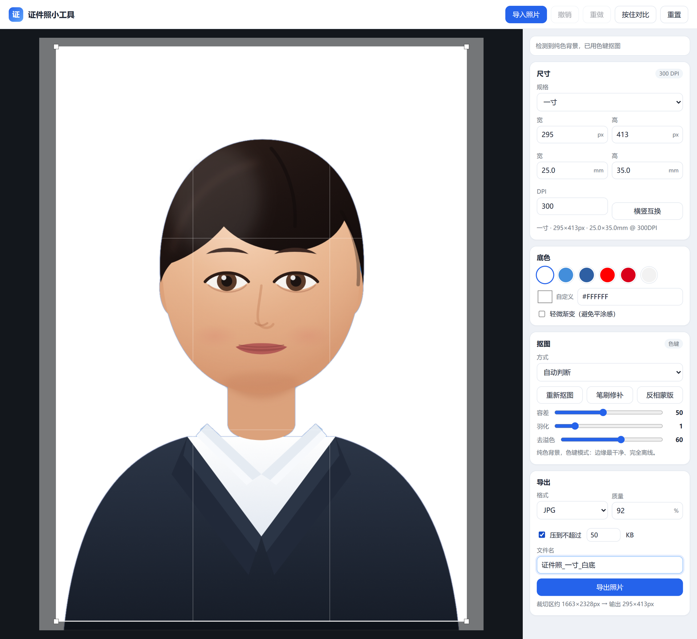
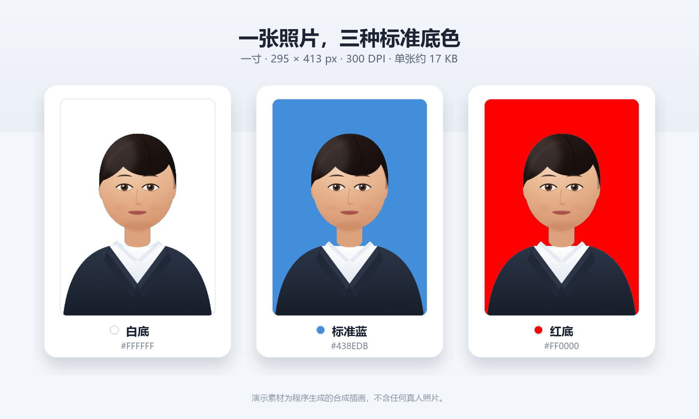
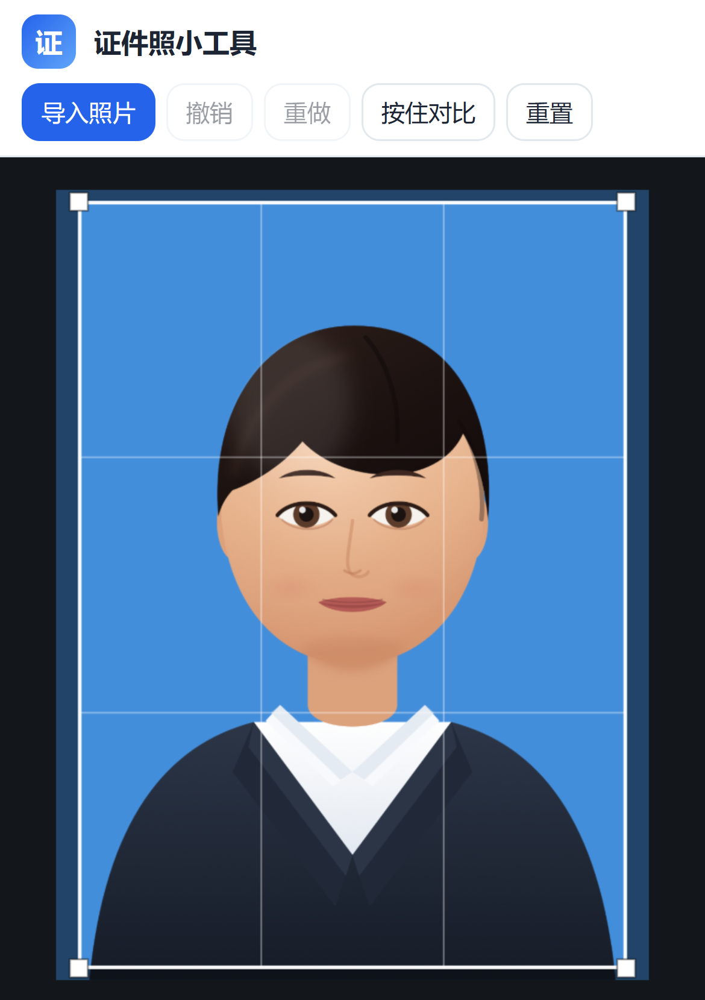
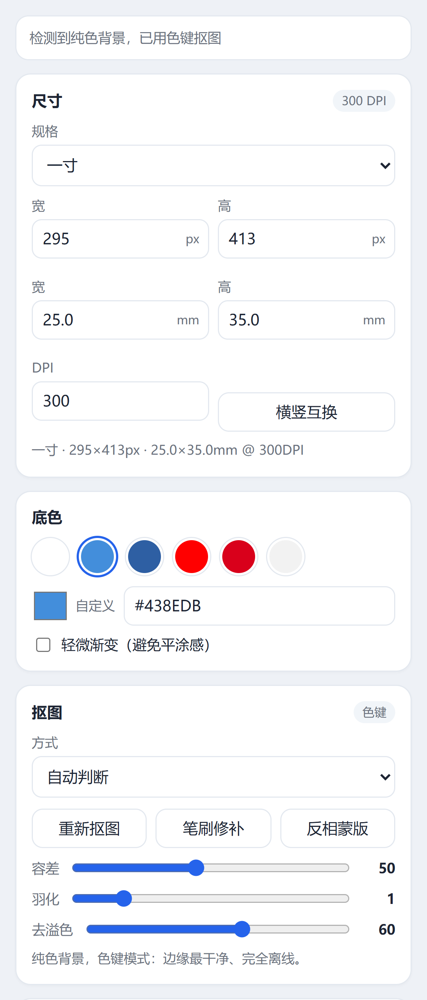
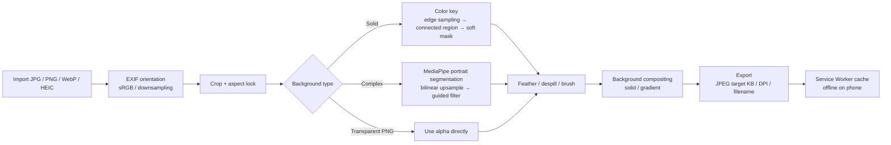

<div align="center">

<h1>🪪 ID Photo Studio</h1>
<h3>Crop, replace the background, hit a target KB — your photo never leaves your device.</h3>
<p><strong>A privacy-first ID photo studio that runs entirely in your browser.</strong></p>
<p>Double-click to start. No Python, Node or database required; deploy it as an offline PWA for your phone.<br>
No account, no upload, no tracking.</p>

<p>


<a href="https://jmlistening.github.io/id-photo-studio/"></a>


</p>

<p><a href="README.md">English</a> | <a href="README.zh-CN.md">简体中文</a></p>

</div>

---

**[Live Demo](https://jmlistening.github.io/id-photo-studio/)** · **[Overview](#-overview)** · **[Features](#-features)** · **[Demo](#-demo)** · **[Privacy and security](#-privacy-and-security)** · **[Quick start](#-quick-start)** · **[Engineering](#-engineering)** · **[Testing and quality](#-testing-and-quality)** · **[Design notes](docs/DESIGN.md)** · **[Changelog](CHANGELOG.md)**

> **TL;DR** — ID Photo Studio is a zero-backend, zero-build web app for turning an ordinary photo into an ID photo: choose a spec (one-inch, passport, visa, exam, etc.), crop, replace the background with a color-key or an on-device MediaPipe portrait model, fine-tune the edges with a brush, and export a JPG/PNG at the exact pixel size and DPI metadata—with an optional file-size budget for JPG. All processing happens in the browser; photos are never uploaded. It ships with a Windows one-click launcher and works as an installable PWA after the first HTTPS load. MIT licensed.

## ✨ Overview

ID-photo requirements are fragmented: one-inch, two-inch, passport, visa, exam registration—every platform has its own size, background color, DPI and file-size limits. Online tools often ask you to upload the photo to someone else's server; local tools often require Python or Node.

This project turns the whole flow into a **pure static web page**:

**Import → choose a spec / crop → replace background → clean edges → export**

- **Your photo stays on your device**: decoding, segmentation, compositing and encoding all happen in the browser's Canvas / TypedArray. There is no upload endpoint.
- **Double-click to start**: on Windows, `启动.bat` starts a read-only static server with the built-in PowerShell. No runtime installation.
- **Two background engines**: color-key for solid backgrounds (fastest, cleanest edges), MediaPipe portrait segmentation for complex scenes; both can be repaired with a brush.
- **Controllable size and file size**: 17 common presets plus custom mm / px / DPI, 300 / 350 DPI metadata, and JPEG target-KB compression.
- **Works on your phone**: open it over the same Wi-Fi, or deploy the static files to any HTTPS host and install it as a PWA.
- **Verifiable**: 9 built-in browser self-tests, demo mode, AI test, export test, Service Worker test; GitHub Actions runs headless-browser smoke tests.

### Live screenshots

> Captured from the real app running locally on Windows. The demo portrait is a **programmatically generated synthetic illustration** ([SVG source](docs/demo/synthetic-portrait.svg)); it does not depict a real person.

<p align="center">
  
</p>

<p align="center"><sub>Import the synthetic demo portrait → detect a solid background → color-key it to white → set a 50 KB target and export. The right panel shows the spec, background, matting controls and export options.</sub></p>

## 🚀 Features

| Module | What it does | Implementation notes |
| --- | --- | --- |
| **Import** | Click, drag and drop, or `Ctrl+V`; JPG / PNG / WebP / HEIC; phone gallery or camera | `createImageBitmap` decoding, local `heic2any` for HEIC, EXIF orientation correction; browser handles sRGB |
| **Specs** | One-inch, small one-inch, large one-inch, two-inch, small two-inch, large two-inch, ID card, social security card, passport, driver's license, US / Japan / Schengen visa, CET-4/6, teacher certification / civil service, postgraduate exam, computer exam; custom mm / px / DPI | 17 presets; `px = round(mm / 25.4 × dpi)`; aspect lock; rotate orientation |
| **Crop** | Drag, corner resize, grid, reset, press-and-hold compare | Normalized crop coordinates; preview is limited to 1600 px on the longest edge; export resamples from the original |
| **Background** | White, standard blue, deep blue, red, true red, light grey, custom color; subtle gradient | Color-key + portrait AI engines; tolerance, feathering and despill sliders |
| **AI matting** | Portrait segmentation for complex backgrounds; auto-crop around a detected face in AI mode | MediaPipe Selfie Segmenter; bilinear mask upsampling + guided-filter refinement; GPU failure falls back to CPU |
| **Manual repair** | Erase / restore brush, brush size, invert mask | Edits the alpha mask directly; up to 12 undo steps |
| **Export** | JPG / PNG; JPEG quality number; JPEG target KB (PNG is lossless); 300 / 350 DPI metadata; clean filenames | JPEG quality binary search 0.3–0.95 (8 iterations); JFIF APP0 for JPEG, `pHYs` for PNG; illegal filename characters filtered |
| **Offline / PWA** | Cache the page, runtime and models after the first HTTPS load; install to the home screen | Service Worker cache-first, about 16 MB; caches only the SIMD or non-SIMD wasm pair the browser needs; Service Workers cannot register over plain LAN HTTP |
| **Local launcher** | Double-click on Windows; opens the browser; prints LAN addresses | `启动.bat` → `server.ps1`; a PowerShell `TcpListener` serves an allowlist of app files, with automatic port fallback |
| **Quality** | Self-tests, demo, AI test, export test, Service Worker test; CI smoke tests | URL flags such as `?selftest=1`; headless Chromium covers the critical paths |

### Core stack

| Layer | Technology | Responsibility |
| --- | --- | --- |
| UI | **Vanilla HTML / CSS / JavaScript** | No framework, no build step; Canvas 2D handles preview and compositing |
| Matting | **Canvas color-key + MediaPipe Tasks Vision** | Solid-background keying; portrait segmentation for complex scenes; guided-filter edge refinement |
| Decoding | **`createImageBitmap` + heic2any** | JPG / PNG / WebP / HEIC; EXIF orientation; downsampling for large images |
| Export | **Canvas `toBlob` + binary header patching** | JPEG / PNG encoding; JPEG target KB; JFIF / `pHYs` DPI metadata |
| Offline | **Service Worker + Web App Manifest** | About 16 MB precache; install to home screen; offline use |
| Launcher | **PowerShell `TcpListener`** | Zero-dependency Windows static server; phone access on the same Wi-Fi |
| Tests | **Playwright + built-in browser tests** | Unit checks, color-key, DPI, target KB, export, Service Worker cache |

## 🎨 Demo

The same synthetic portrait with three common backgrounds. All three photos were **actually exported by the app** at 295 × 413 px / 300 DPI / about 17 KB JPEG; the image below is a comparison composite (not a mockup):

<p align="center">
  
</p>

| Situation | Recommended engine | Why |
| --- | --- | --- |
| Studio solid background, ID-photo re-shoot | **Color key** | Color distance + boundary connectivity; cleanest edges, fully offline, fastest |
| Phone snapshot, indoor/outdoor complex background | **Portrait AI** | MediaPipe segmentation for non-solid backgrounds; use the brush if hair edges need work |
| The source already has transparency | **Use alpha directly** | No need to segment again when an alpha channel is present |
| Neither works well | **Brush / invert mask** | Erase leftover background or restore areas that were removed |

### How the two engines work

**Color key**: samples the top and side edges, estimates the dominant background color and variance, grows connected regions from those boundary seeds, turns color distance into a soft 0–255 alpha, and applies despill to remove background color from semi-transparent edges. A studio photo on a solid background usually comes out clean in one pass.

**Portrait AI**: dynamically loads MediaPipe Tasks Vision (about 15 MB of wasm plus 250 KB of models), runs Selfie Segmenter to produce a confidence mask, upsamples it bilinearly to the working resolution, refines hair and silhouette edges with a guided filter using the original luminance, then applies the same feather, despill and background compositing path. The model loads on first use and is cached by the Service Worker for offline use.

If the AI model fails to load, or the page is opened directly from `file://`, the app shows a clear message; automatic mode falls back to color-key + brush without blocking the flow. The app does **not** decide whether a photo is a portrait—if segmentation looks wrong, use the brush or switch back to the color-key engine.

## 🔒 Privacy and security

This is the part of the project we care about most, and the part with the least "magic":

- **No photo upload**: no backend, no upload endpoint, no object storage. All pixel work happens in the browser's Canvas / TypedArray.
- **No server state**: the local launcher only reads static files; there is no database, account or session.
- **No analytics or tracking**: no Google Analytics, Baidu Analytics, Sentry, cookies or third-party runtime fonts. The upstream MediaPipe runtime contains an anonymous telemetry logger; the app blocks it with a `Content-Security-Policy: connect-src 'self'`. No photo pixels are ever part of that request.
- **The app only requests same-origin static assets**: the page, scripts, wasm and models; after the first load they are cached by the Service Worker for offline use. The upstream telemetry request is blocked by CSP and never leaves the browser.
- **No photo persistence**: nothing is uploaded, nothing is written to IndexedDB or localStorage; closing the page releases the image.
- **Synthetic demo assets**: the demo portrait is drawn by an SVG program; no real person is depicted. Screenshots contain no browser bookmarks, desktop or personal files.
- **No secrets or personal data in the repo**: no `.env`, API keys, email addresses, local absolute paths or private photos; `.gitignore` excludes local deployment packages and scratch files. The upstream MediaPipe wasm embedded a public Google API key for its telemetry logger; it has been replaced with a same-length placeholder in the vendored copy, and the request is additionally blocked by CSP. See [THIRD_PARTY_NOTICES.md](THIRD_PARTY_NOTICES.md).

**Boundary**: this model protects against "photo uploaded to a server, collected by a server, or measured by a third-party analytics SDK". It does not protect against malicious browser extensions, a compromised input method or operating system, or you voluntarily sharing an exported image. A static host will still see ordinary HTTP metadata (IP address, timestamps, requested paths), but **it never receives the photo content**.

The local launcher binds to `0.0.0.0` by default so a phone on the same Wi-Fi can connect; it only exposes the files the app needs (`index.html`, `app.js`, `specs.js`, `styles.css`, `sw.js`, `manifest.webmanifest`, `icons/`, `vendor/` and the OG image). `.git/`, `.work/`, `tests/`, `部署包.zip` and similar local paths return 404. If you do not need phone access, change the listener in `server.ps1` to `127.0.0.1`.

## ⚡ Quick start

### Windows: double-click (recommended)

1. Double-click **`启动.bat`**.
2. Your browser opens `http://localhost:8765/`.
3. Import a photo → drag the crop frame → pick a background color → export.

- Keep the launcher window open; closing it stops the local server.
- No Python, Node or other runtime is required; the launcher uses the built-in Windows PowerShell.
- If the port is busy, the script automatically tries the next free port; use the address printed in the window.

### Open `index.html` directly (degraded mode)

You can also double-click `index.html`, but browsers restrict `file://`: **AI matting is unavailable**, leaving color-key + manual brush; a banner explains this. Use `启动.bat` when you need AI.

### Phone

#### Option A: same Wi-Fi (computer must stay on)

1. Double-click `启动.bat` on the computer.
2. The launcher prints `Phone (same Wi-Fi): http://192.168.x.x:8765/`.
3. Open that address in the phone browser.

The address stops working when the computer sleeps or shuts down. On first launch, allow PowerShell / the private network through the Windows firewall if prompted.

#### Option B: install to the home screen (recommended; computer can be off)

Deploy the static files to any HTTPS host (GitHub Pages, Cloudflare Pages, Netlify, etc.; the platform's free URL is fine). Open it once in the phone's system browser and choose "Add to Home Screen".

- **The first install needs a network connection** and caches about 16 MB (page + AI models; only the SIMD or non-SIMD wasm pair the browser needs).
- **After that it is fully offline**: photo processing and AI matting run on the phone.
- **In-app browsers such as WeChat are not suitable for PWA installation**; use Safari / Chrome / Edge.

<p align="center">
  
  &nbsp;&nbsp;
  
</p>

<p align="center"><sub>Mobile: canvas on top, settings panel below; the controls adapt to the screen width.</sub></p>

| Platform | Notes |
| --- | --- |
| GitHub Pages | The repo includes a deployment workflow; free, but access from mainland China can be unstable |
| Cloudflare Pages | Free drag-and-drop deployment; `pages.dev` may be restricted in mainland China |
| Netlify | Free drag-and-drop deployment; access from mainland China can be unstable |
| Tencent EdgeOne Pages / CloudBase | Domestic platforms with limited free quotas; default domains may be restricted and stable access usually requires ICP filing |

This app is pure static—**no server, database or backend**. For a manual deployment, upload only these files; do not drag the entire repository root (it may contain `.git/`, `.work/`, `部署包.zip` and other local files):

```text
index.html  app.js  specs.js  styles.css  sw.js  manifest.webmanifest
icons/  vendor/  LICENSE  THIRD_PARTY_NOTICES.md
docs/images/bg-variants.png   # social preview image only
```

The local `部署包.zip` is a generated build artifact and is excluded from Git. The GitHub Pages workflow uses an allowlisted staging directory and never publishes `.git/` or local scratch files.

### Deploy to GitHub Pages

The repository includes `.github/workflows/pages.yml`. Before the first deployment, open **Settings → Pages → Build and deployment → Source** and select **GitHub Actions**. After that, each push to `main` deploys only after the `CI` smoke tests pass (`workflow_run`); a failing test never goes live. You can also run `Deploy to GitHub Pages` manually, but it is restricted to `main`.

## 🧭 Engineering

The project is deliberately **framework-free, build-free and backend-free**:



### Key decisions

- **No frontend framework**: the app is one IIFE plus a few canvases; no npm, no bundler, copy the folder and run. The trade-off is hand-written state management, but deployment friction is minimal.
- **Preview and export are separated**: preview and matting run on a working canvas limited to 1600 px on the longest edge; export resamples the original at the target pixel size, avoiding "downscale then upscale" blur.
- **The mask is the central intermediate layer**: color key, AI, brush and invert all write to the same alpha mask; compositing, feathering, despill and export share one path, so behavior is predictable.
- **File size is not "compress it a few more times"**: JPEG target KB uses an 8-step binary search for the highest quality that stays under the target; if that is impossible, the app tells you the smallest achievable size instead of silently shrinking the image.
- **DPI is written into the bytes**: JPEG rewrites the JFIF APP0 density fields; PNG inserts or replaces the `pHYs` chunk and recomputes CRC32—not just a number in the UI.
- **Offline is a cache strategy, not a slogan**: the Service Worker precaches the page, scripts, wasm and models; cache-first with a network fallback means the phone works fully offline after the first online load.

More algorithm, coordinate-system, parameter and test details are in **[docs/ENGINEERING.md](docs/ENGINEERING.md)** (currently in Chinese); product decisions and the timeline are in **[docs/DESIGN.md](docs/DESIGN.md)** (also in Chinese). The English README covers the essentials.

## 📐 Presets

| Preset | Physical size | Pixels | DPI | Common background |
| --- | --- | --- | --- | --- |
| One-inch (一寸) | 25×35 mm | 295×413 | 300 | White / blue / red |
| Small one-inch (小一寸) | 22×32 mm | 260×378 | 300 | White |
| Large one-inch (大一寸) | 33×48 mm | 390×567 | 300 | White / blue |
| Two-inch (二寸) | 35×49 mm | 413×579 | 300 | White / blue / red |
| Small two-inch (小二寸) | 35×45 mm | 413×531 | 300 | White |
| Large two-inch (大二寸) | 35×53 mm | 413×626 | 300 | White / blue |
| ID card (身份证) | 26×32 mm | 358×441 | 350 | White |
| Social security card (社保卡) | 26×32 mm | 358×441 | 350 | White |
| Passport (护照) | 33×48 mm | 390×567 | 300 | White |
| Driver's license (驾驶证) | 22×32 mm | 260×378 | 300 | White |
| US visa (美国签证) | 51×51 mm | 600×600 | 300 | White |
| Japan visa (日本签证) | 45×45 mm | 531×531 | 300 | White |
| Schengen / Korea visa (申根/韩国签证) | 35×45 mm | 413×531 | 300 | White |
| CET-4/6 (四六级) | — | 144×192 | 300 | White / blue |
| Teacher certification / civil service (教资/公务员) | 25×35 mm | 295×413 | 300 | White / blue |
| Postgraduate exam (考研) | — | 480×640 | 300 | White / blue |
| Computer exam (计算机等级) | — | 144×192 | 300 | White |

All presets can be edited or extended in `specs.js`; physical sizes and DPI convert both ways. **Specs and background requirements change by region and year—always check the official announcement for the current application before exporting.**

## 🧪 Testing and quality

### Built-in browser tests

Open these URLs; no installation is required:

| URL | What it checks |
| --- | --- |
| `index.html?selftest=1` | Size conversion, filename sanitization, solid-background detection, color-key mask, JPEG/PNG DPI, target-KB encoding (9 checks) |
| `index.html?exporttest=1` | Full export path: encoding, dimensions, DPI and signatures for both JPEG and PNG |
| `index.html?demo=1` | Loads the synthetic demo portrait and shows the UI/background result |
| `index.html?aitest=1` | Loads the AI model and segments the demo image (the model files must be reachable, about 15 MB) |
| `index.html?swtest=1` | Registers the Service Worker and checks the cache entries |

### Automation

The repository includes GitHub Actions:

- **CI**: headless Chromium runs `selftest`, `exporttest` (JPEG + PNG), `demo`, the PNG-control check and `swtest`; a separate Windows job parses `server.ps1` under Windows PowerShell 5.1.
- **Pages**: after CI succeeds, a `workflow_run` deploys the static site to GitHub Pages.

Reproduce CI locally:

```bash
python -m pip install -r tests/requirements.txt
python -m playwright install chromium
python tests/smoke.py
```

The AI test is not part of CI: the model + wasm are large and GPU/CPU behavior differs across runners. To verify AI, run `?aitest=1` in a real browser.

### Browser support

- Primary targets: desktop Chrome / Edge; Safari is best-effort.
- Phone: Android Chrome, iOS Safari; in-app browsers such as WeChat have poorer compatibility.
- Opening `file://` directly is degraded mode: color key, crop and export work; AI does not.
- Plain LAN HTTP is not a secure context, so the Service Worker cannot register; installing a PWA requires HTTPS.

## 📁 Project structure

```text
id-photo-studio/
├─ 启动.bat                  # Windows double-click launcher
├─ server.ps1                # PowerShell static server (no install)
├─ index.html
├─ styles.css
├─ app.js                    # all business logic (about 2.3k lines)
├─ specs.js                  # spec / background presets
├─ sw.js                     # Service Worker offline cache
├─ manifest.webmanifest      # PWA manifest
├─ icons/                    # desktop icons
├─ vendor/
│  ├─ lib/heic2any.min.js
│  ├─ mediapipe/             # AI runtime (wasm)
│  ├─ models/                # portrait segmentation + face detection models
│  └─ LICENSES/              # third-party license texts
├─ docs/
│  ├─ DESIGN.md              # product design notes (Chinese)
│  ├─ ENGINEERING.md         # engineering notes (Chinese)
│  ├─ demo/                  # synthetic demo portrait (SVG)
│  └─ images/                # README screenshots
├─ tests/
│  └─ smoke.py               # headless-browser smoke tests
├─ .github/workflows/        # CI + Pages
├─ LICENSE
├─ SECURITY.md
├─ CHANGELOG.md
├─ THIRD_PARTY_NOTICES.md
├─ README.zh-CN.md           # Chinese README
└─ README.md
```

## ⚠️ Known limitations

- **The AI is a lightweight model**: about 250 KB of Selfie Segmenter + about 15 MB of runtime; hair edges are not perfect. Use the brush for complex backgrounds.
- **Solid backgrounds work best**: the color key needs enough contrast between the subject and the background; use "Portrait AI" for complex scenes.
- **Specs change**: presets are common values and may be adjusted by region/year; confirm the official announcement before exporting.
- **Opening the HTML directly is degraded mode**: AI and the Service Worker are unavailable; the page explains this.
- **LAN HTTP cannot install a PWA**: Service Workers require HTTPS or localhost; offline phone use needs static hosting.
- **The launcher is Windows-only**: the web app is cross-platform, but `启动.bat` / `server.ps1` are Windows-specific; on macOS/Linux use any static server.
- **No batch, full-set export, print sheets, beauty retouching or suit replacement**: these are on the roadmap; v1 does "crop + background + one image" only.
- **PNG has no target KB or quality control**: PNG is lossless, so those two controls apply to JPEG only; they are disabled and explained when PNG is selected.
- **Large images are downsampled for preview**: the working canvas is limited to 1600 px on the longest edge; export still resamples the original, but preview/mask precision is limited by this.

## 🗺️ Roadmap

- [ ] Batch import, shared settings, queue processing, open failed items individually
- [ ] Full-set export (one-inch/two-inch × red/blue/white) as a zip
- [ ] 6-inch photo-paper layout with cut marks
- [ ] Beauty sliders (skin smoothing, blemish removal, brightening, face slimming, eye enlargement), off by default with an official-review warning
- [ ] Smart suit replacement (local template alignment; no generative clothing)
- [ ] More specs and saved custom presets

> Unimplemented features are never presented as "supported" in the README. If you need one of these, open an issue and describe your use case.

## 📜 License and third-party

- Project code: **MIT License**, see [LICENSE](LICENSE).
- **MediaPipe Tasks Vision**: Apache-2.0; full text in [vendor/LICENSES/Apache-2.0.txt](vendor/LICENSES/Apache-2.0.txt).
- **MediaPipe Selfie Segmenter / BlazeFace models**: from MediaPipe, Apache-2.0.
- **heic2any**: MIT; full text in [vendor/LICENSES/heic2any-MIT.md](vendor/LICENSES/heic2any-MIT.md); it bundles **libheif** (LGPL-3.0), full text in [vendor/LICENSES/LGPL-3.0.txt](vendor/LICENSES/LGPL-3.0.txt).
- Icons and demo portrait: generated for this project and released under the same MIT license.
- Sources, versions, the libheif source/relinking offer, and the MediaPipe telemetry / public-key handling are documented in [THIRD_PARTY_NOTICES.md](THIRD_PARTY_NOTICES.md).

## ❓ FAQ

**The launcher window closes immediately?**  
Try "Run as administrator", or run `powershell -ExecutionPolicy Bypass -File server.ps1` in PowerShell to see the error.

**The port is already in use?**  
The script tries the next free port; use the address printed in the window.

**The phone cannot open the LAN address?**  
Confirm both devices are on the same Wi-Fi, the computer is awake, and the firewall allows PowerShell / the private network.

**Can the phone still work after the computer is off?**  
Yes with Option B (install to the home screen); no with Option A, because the phone is connecting to the computer.

**Is the photo uploaded?**  
No. There is no upload code, backend or analytics. You can verify in the browser's Network panel: apart from same-origin page/model assets, no request carries an image.

**Does AI mode send data to Google?**  
The upstream MediaPipe runtime contains an anonymous telemetry reporter (platform/version/timing, no photo pixels). This project blocks it with a CSP `connect-src 'self'`; at most you will see a blocked request in the Network/console, never a successful outbound request. Details are in [THIRD_PARTY_NOTICES.md](THIRD_PARTY_NOTICES.md).

**Why is `部署包.zip` not in the repository?**  
It is a generated local build artifact and is excluded by `.gitignore`. For a manual deployment, follow the file list above; do not drag the whole repository root, or `.git/`, `.work/` and other local files may be published.

## ⚖️ Disclaimer

This is a personal tool and does not guarantee acceptance by any official review. ID-photo specs, background colors, head proportions and file-size limits are governed by the current announcement of the application system / issuing authority; verify them before exporting. The app does not modify facial features, face shape or skin tone; replacing the background is not "beautification".

---

<div align="center">
<sub>If this tool saves you a trip to a photo studio, a ⭐ Star is appreciated.</sub>
</div>
