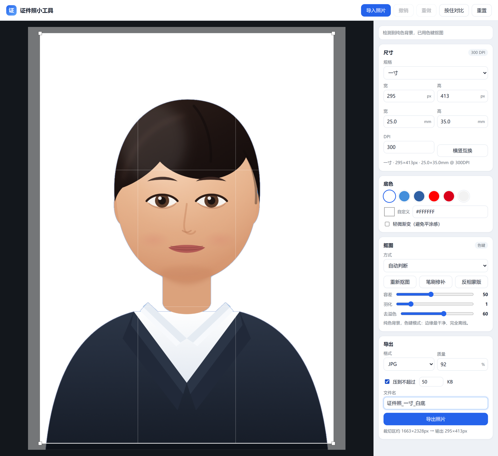
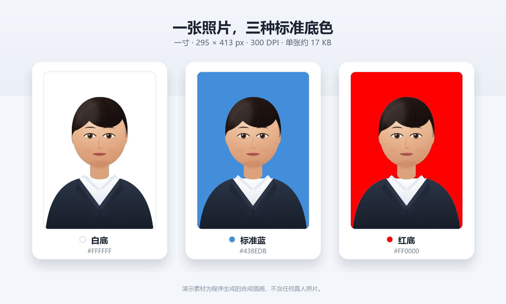
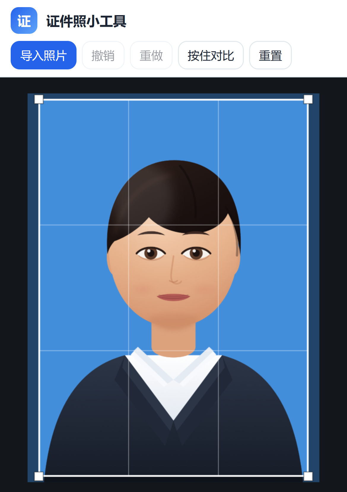
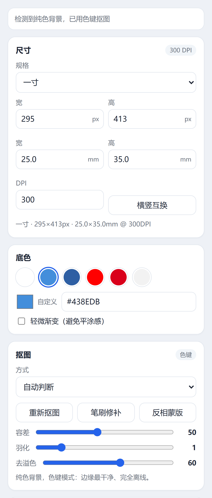
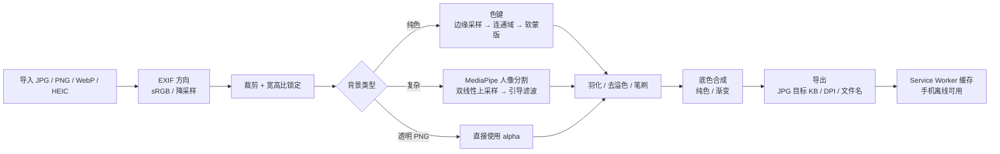

<div align="center">

<h1>🪪 证件照小工具 · ID Photo Studio</h1>
<h3>裁尺寸、换底色、把 JPG 压到指定 KB——照片始终留在自己的设备里。</h3>
<p><strong>A privacy-first ID photo studio that runs entirely in your browser.</strong></p>
<p>双击启动，无需安装 Python / Node / 数据库；也可以部署成 PWA，手机离线使用。<br>
没有账号、没有上传、没有埋点。</p>

<p>


<a href="https://jmlistening.github.io/id-photo-studio/"></a>


</p>

<p><a href="README.md">English</a> · <a href="README.zh-CN.md"><strong>简体中文</strong></a></p>

</div>

---

**[在线试用](https://jmlistening.github.io/id-photo-studio/)** · **[项目概览](#-项目概览)** · **[功能一览](#-功能一览)** · **[效果演示](#-效果演示)** · **[隐私与安全模型](#-隐私与安全模型)** · **[快速开始](#-快速开始)** · **[工程实现](#-工程实现)** · **[测试与质量](#-测试与质量)** · **[工程设计](docs/DESIGN.md)** · **[更新记录](CHANGELOG.md)**

> **English TL;DR** — ID Photo Studio is a zero-backend, zero-build web app for turning an ordinary photo into an ID photo: choose a spec (one-inch, passport, visa, exam, etc.), crop, replace the background with a color-key or an on-device MediaPipe portrait model, fine-tune the edges with a brush, and export a JPG/PNG at the exact pixel size and DPI metadata—with an optional file-size budget for JPG. All processing happens in the browser; photos are never uploaded. It ships with a Windows one-click launcher and works as an installable PWA after the first HTTPS load. MIT licensed.

## ✨ 项目概览

证件照的需求很碎：一寸、二寸、护照、签证、考试报名，每个平台对尺寸、底色、DPI 和文件大小都有不同要求。在线工具往往要先把照片传到别人的服务器，装一个本地工具又得先配 Python / Node 环境。

这个项目把整条链路做成一个**纯静态网页**：

**导入 → 选规格 / 裁剪 → 换底色 → 修边缘 → 导出**

- **照片不出设备**：Canvas 在浏览器内存里完成解码、抠图、合成和编码，没有上传接口。
- **双击即用**：Windows 下双击 `启动.bat`，用系统自带的 PowerShell 起一个只读静态服务；不需要安装任何运行时。
- **双引擎换底**：纯色底用色键（最快、边缘最干净），复杂背景用 MediaPipe 人像分割；两者都能手动用笔刷修。
- **尺寸和文件大小可控**：17 个常用规格 + 自定义 mm / px / DPI，导出可写入 300 / 350 DPI；JPG 还能压到指定 KB 上限。
- **手机可用**：同一 Wi-Fi 直接访问；或部署到任意 HTTPS 静态托管，首次加载后作为 PWA 离线使用。
- **可验证**：内置 9 项浏览器自测、演示模式、AI 测试、导出测试和 Service Worker 测试；GitHub Actions 跑无头浏览器冒烟测试。

### 实际运行界面

> 截图取自 Windows 本地真实运行。演示人像是**程序生成的合成插画**（[SVG 源文件](docs/demo/synthetic-portrait.svg)），不包含任何真人照片。

<p align="center">
  
</p>

<p align="center"><sub>导入合成演示人像 → 自动识别纯色背景 → 色键换白底 → 设置 50KB 目标并导出。右侧同时显示规格、底色、抠图参数和导出选项。</sub></p>

## 🚀 功能一览

| 模块 | 具体能力 | 实现要点 |
| --- | --- | --- |
| **导入** | 点击、拖拽、`Ctrl+V` 粘贴；JPG / PNG / WebP / HEIC；手机相册/拍照 | `createImageBitmap` 解码，HEIC 走本地 `heic2any`；读取 EXIF 方向；浏览器统一按 sRGB 处理 |
| **规格** | 一寸、小一寸、大一寸、二寸、小二寸、大二寸、身份证、社保卡、护照、驾驶证、美/日/申根签证、四六级、教资/公务员、考研、计算机等级；自定义 mm / px / DPI | 17 个预设；`px = round(mm / 25.4 × dpi)`；宽高比锁定；横竖互换 |
| **裁剪** | 拖动、四角缩放、网格参考、重置裁剪、按住对比原图 | 归一化裁剪坐标；预览画布最长边限制 1600px，导出时按目标像素从原图重采样 |
| **换底** | 白、标准蓝、深蓝、红、正红、浅灰、自定义色；轻微渐变 | 色键引擎 + 人像 AI 双引擎；容差、羽化、去溢色滑杆 |
| **AI 抠图** | 复杂背景人像分割；AI 模式下检测到人脸时自动调整构图 | MediaPipe Selfie Segmenter；置信度蒙版双线性上采样 + 引导滤波细化；GPU 失败自动回退 CPU |
| **手动修补** | 擦除 / 恢复笔刷、笔刷大小、蒙版反相 | 直接修改 alpha 蒙版；最多 12 步撤销/重做 |
| **导出** | JPG / PNG；JPG 质量数值；JPG 目标 KB（PNG 为无损格式）；300 / 350 DPI 元数据；规范文件名 | JPEG 质量 0.3–0.95 二分搜索（8 次）；JPG 写 JFIF APP0，PNG 写 `pHYs`；文件名过滤非法字符 |
| **离线 / PWA** | 首次 HTTPS 加载后缓存页面、运行时和 AI 模型；可添加到手机主屏幕 | Service Worker cache-first，约 16MB；按浏览器能力只缓存 SIMD 或非 SIMD 的那一对 wasm；局域网 HTTP 下无法注册 SW |
| **本地启动器** | Windows 双击启动；自动打开浏览器；打印局域网地址 | `启动.bat` → `server.ps1`，PowerShell `TcpListener` 实现只读静态服务，只暴露应用文件，端口占用自动顺延 |
| **质量保障** | 自测、演示、AI 测试、导出测试、SW 测试；CI 冒烟测试 | `?selftest=1` 等 URL 参数；无头 Chromium 跑关键路径 |

### 核心技术栈

| 层次 | 技术 | 承担的职责 |
| --- | --- | --- |
| 界面 | **原生 HTML / CSS / JavaScript** | 无框架、无构建步骤；Canvas 2D 负责预览与合成 |
| 抠图 | **Canvas 色键 + MediaPipe Tasks Vision** | 纯色背景色键；复杂背景人像分割；引导滤波边缘细化 |
| 解码 | **`createImageBitmap` + heic2any** | JPG / PNG / WebP / HEIC；EXIF 方向；大图降采样 |
| 导出 | **Canvas `toBlob` + 二进制头修补** | JPEG / PNG 编码；JPG 目标 KB；JFIF / `pHYs` DPI 元数据 |
| 离线 | **Service Worker + Web App Manifest** | 预缓存约 16MB；安装到主屏幕；离线可用 |
| 启动 | **PowerShell `TcpListener`** | Windows 零依赖本地静态服务器；手机同 Wi-Fi 访问 |
| 测试 | **Playwright + 浏览器内置自测** | 尺寸换算、色键、DPI、目标 KB、导出、SW 缓存 |

## 🎨 效果演示

同一张合成演示人像，三种常用底色；三张照片都由应用**真实导出**为 295 × 413 px / 300 DPI / 约 17KB JPEG，下面是把它们拼在一起的对比图（不是设计稿）：

<p align="center">
  
</p>

| 场景 | 推荐引擎 | 原因 |
| --- | --- | --- |
| 照相馆纯色底、证件照翻拍 | **色键** | 颜色距离 + 边界连通，边缘最干净，完全离线，速度最快 |
| 手机随手拍、室内外复杂背景 | **人像 AI** | MediaPipe 人像分割，适合非纯色背景；发丝不完美时可再用笔刷 |
| 原图已经是透明 PNG | **直接使用 alpha** | 检测到透明通道时不再重复抠图 |
| 两种都不理想 | **手动笔刷 / 反相蒙版** | 擦除多余背景，或恢复被误删的人像 |

### 双引擎是怎么工作的

**色键引擎**：从顶部和左右两侧边缘采样，做主色聚类和方差判断；以这些边界为种子做连通域生长，按颜色距离生成 0–255 的软 alpha；再用去溢色把半透明边缘里的底色成分减掉。纯色底证件照通常一次就能得到干净边缘。

**人像 AI**：动态加载 MediaPipe Task Vision（约 15MB wasm + 250KB 模型），用 Selfie Segmenter 输出置信度蒙版；双线性上采样到工作分辨率，再用原图亮度作为引导做引导滤波，细化发丝和轮廓；最后同样经过羽化、去溢色和底色合成。AI 模型只在首次使用时加载，之后由 Service Worker 缓存离线可用。

如果 AI 模型加载失败，或页面是 `file://` 直接打开，应用会明确提示；自动模式下会退回色键 + 手动笔刷，不阻塞主流程。应用不判断“照片是不是人像”，分割结果不理想时请用笔刷修，或换回色键引擎。

## 🔒 隐私与安全模型

这是这个项目最在意的部分，也是代码里最少“魔法”的部分：

- **照片不上传**：没有后端、没有上传接口、没有对象存储。所有像素处理都在浏览器的 Canvas / TypedArray 里完成。
- **不写服务器**：本地启动器只提供静态文件读取；没有数据库、没有账号、没有会话。
- **没有统计和埋点**：不引入 Google Analytics、百度统计、Sentry、Cookie 追踪或第三方字体。MediaPipe 上游运行时自带的匿名遥测会用 CSP 的 `connect-src 'self'` 在浏览器层面阻断；照片像素不在任何请求里。
- **应用自身只请求同源静态资源**：页面、脚本、wasm 和模型；这些资源首次加载完成后由 Service Worker 缓存，之后可离线使用。上游遥测请求被 CSP 拦截，不会发出。
- **照片不持久化**：不上传、不写 IndexedDB、不写 localStorage；关闭页面即释放。
- **截图和演示素材全部是合成的**：仓库里的演示人像由 SVG 程序绘制，不含真人照片；截图不包含浏览器书签、桌面或个人文件。
- **仓库不含密钥和个人信息**：没有 `.env`、API Key、邮箱、本机绝对路径或私人照片；`.gitignore` 也排除了本地部署包和临时文件。MediaPipe 上游 wasm 里用于遥测的公共 Google key，已在 vendored 副本中替换为等长占位符；遥测另由 CSP 阻止。来源和处理方式见 [THIRD_PARTY_NOTICES.md](THIRD_PARTY_NOTICES.md)。

**边界说明**：这套模型防的是“照片被上传、被服务器收集、被第三方统计”。它不防浏览器扩展、恶意输入法、被攻破的操作系统或你自己把导出图发给了别人。如果通过静态托管访问，托管方仍然会看到普通的 HTTP 请求（IP、时间、资源路径），但**不会收到照片内容**。

本地启动器默认绑定 `0.0.0.0`，方便手机连同一 Wi-Fi；它只读静态文件，没有上传端点。它只暴露应用真正需要的文件（`index.html`、`app.js`、`specs.js`、`styles.css`、`sw.js`、`manifest.webmanifest`、`icons/`、`vendor/` 和 OG 图片），`.git/`、`.work/`、`tests/`、`部署包.zip` 等路径返回 404。如果你不需要手机访问，可以把 `server.ps1` 里的监听地址改成 `127.0.0.1`。

## ⚡ 快速开始

### Windows：双击启动（推荐）

1. 双击 **`启动.bat`**。
2. 浏览器自动打开 `http://localhost:8765/`。
3. 导入照片 → 拖裁剪框 → 选底色 → 导出。

- 启动窗口不要关；关掉后本地服务就停了。
- 不需要安装 Python、Node 或任何运行环境；启动脚本用的是 Windows 自带的 PowerShell。
- 端口被占用时会自动往后找空闲端口，看窗口里打印的实际地址。

### 直接打开 `index.html`（降级模式）

双击 `index.html` 也能用，但浏览器对 `file://` 有限制：**AI 抠图不可用**，只能色键 + 手刷；页面顶部会显示提示。需要 AI 时请用 `启动.bat`。

### 手机使用

#### 方式 A：和电脑连同一个 Wi-Fi（电脑要开着）

1. 电脑双击 `启动.bat`。
2. 启动窗口里会打印 `Phone (same Wi-Fi): http://192.168.x.x:8765/`。
3. 手机浏览器打开这个地址。

电脑关机或休眠后地址失效。首次启动如果 Windows 防火墙弹窗，选择“允许访问专用网络”。

#### 方式 B：装到手机桌面，电脑关机也能用（推荐）

把仓库里的静态文件部署到任意 HTTPS 静态托管（GitHub Pages、Cloudflare Pages、Netlify 等，用平台赠送的地址即可），手机用系统浏览器打开一次并“添加到主屏幕”。

- **首次安装需要联网**，会缓存约 16MB（页面 + AI 模型；按浏览器是否支持 WASM SIMD 只缓存对应的一对 wasm）。
- **装好后完全离线**：照片处理、AI 抠图都在手机本地跑。
- **微信内置浏览器不适合装 PWA**，请用 Safari / Chrome / Edge。

<p align="center">
  
  &nbsp;&nbsp;
  
</p>

<p align="center"><sub>手机端：上方画布 + 下方参数面板，操作区域按屏幕宽度自适应。</sub></p>

| 平台 | 特点 |
| --- | --- |
| GitHub Pages | 仓库里已带部署 workflow；免费，国内访问有时不稳 |
| Cloudflare Pages | 免费、可拖拽上传；`pages.dev` 在国内可能受限 |
| Netlify | 免费、拖拽上传；国内访问不稳定 |
| 腾讯 EdgeOne Pages / CloudBase | 国内平台，免费额度有限；默认域名在大陆可能受限，稳定访问通常要备案 |

这个应用是纯静态的，**不需要服务器、数据库或后端**。手工部署时请只上传这些文件，不要直接把整个仓库根目录拖上去（根目录可能含 `.git/`、`.work/`、`部署包.zip` 等本地内容）：

```text
index.html  app.js  specs.js  styles.css  sw.js  manifest.webmanifest
icons/  vendor/  LICENSE  THIRD_PARTY_NOTICES.md
docs/images/bg-variants.png   # 仅用于社交预览图
```

项目里的 `部署包.zip` 是本地生成的静态打包，默认不提交到 Git。GitHub Pages 的 workflow 使用白名单 staging，不会发布 `.git/` 或本地临时文件。

### 部署到 GitHub Pages

仓库包含 `.github/workflows/pages.yml`。首次使用前，先在仓库 **Settings → Pages → Build and deployment → Source** 选择 **GitHub Actions**；之后每次 push 到 `main`，`CI` 的 smoke 测试通过后才会触发 Pages 发布（`workflow_run`），测试失败不会上线。也可以手动运行 `Deploy to GitHub Pages`，但只允许从 `main` 发布。

## 🧭 工程实现

项目刻意保持**零框架、零构建、零后端**：



### 几个关键决定

- **不引入前端框架**：整个应用是一个 IIFE + 几个 Canvas；没有 npm、没有打包器，复制文件夹就能跑。代价是状态管理靠手写，但换来了极低的部署摩擦。
- **预览与导出分离**：预览/抠图在最长边 1600px 的工作画布上做，导出时按目标像素直接从原图重采样，避免“先缩小再放大”导致发糊。
- **蒙版是核心中间层**：色键、AI、笔刷、反相最终都写进同一张 alpha 蒙版；合成、羽化、去溢色、导出共用同一条路径，行为可预测。
- **文件大小不是“多压几次”**：JPG 目标 KB 用 8 次二分搜索找“不超过目标的最大质量”；压不到时明确提示最小可达大小，而不是偷偷缩尺寸。
- **DPI 写在字节里**：JPEG 改 JFIF APP0 的 density 字段，PNG 插入/替换 `pHYs` chunk 并重算 CRC32；不是只在界面上显示 300 DPI。
- **离线是缓存策略，不是口号**：Service Worker 预缓存页面、脚本、wasm 和模型；`cache-first` + 网络兜底，首次联网后手机可完全离线。

更细的算法、坐标系、参数和测试说明见 **[docs/ENGINEERING.md](docs/ENGINEERING.md)**；产品决策和时间线见 **[docs/DESIGN.md](docs/DESIGN.md)**。

## 📐 规格预设

| 预设 | 物理尺寸 | 像素 | DPI | 常用底色 |
| --- | --- | --- | --- | --- |
| 一寸 | 25×35 mm | 295×413 | 300 | 白/蓝/红 |
| 小一寸 | 22×32 mm | 260×378 | 300 | 白 |
| 大一寸 | 33×48 mm | 390×567 | 300 | 白/蓝 |
| 二寸 | 35×49 mm | 413×579 | 300 | 白/蓝/红 |
| 小二寸 | 35×45 mm | 413×531 | 300 | 白 |
| 大二寸 | 35×53 mm | 413×626 | 300 | 白/蓝 |
| 身份证 | 26×32 mm | 358×441 | 350 | 白 |
| 社保卡 | 26×32 mm | 358×441 | 350 | 白 |
| 护照 | 33×48 mm | 390×567 | 300 | 白 |
| 驾驶证 | 22×32 mm | 260×378 | 300 | 白 |
| 美国签证 | 51×51 mm | 600×600 | 300 | 白 |
| 日本签证 | 45×45 mm | 531×531 | 300 | 白 |
| 申根/韩国签证 | 35×45 mm | 413×531 | 300 | 白 |
| 四六级 | — | 144×192 | 300 | 白/蓝 |
| 教资/公务员 | 25×35 mm | 295×413 | 300 | 白/蓝 |
| 考研 | — | 480×640 | 300 | 白/蓝 |
| 计算机等级 | — | 144×192 | 300 | 白 |

所有预设都可以在 `specs.js` 里修改或新增；物理尺寸与 DPI 可互相换算。**规格和底色要求会随地区/年份变化，导出前请以报名系统当年的公告为准。**

## 🧪 测试与质量

### 浏览器内置测试

打开以下 URL 即可运行，不需要安装任何东西：

| URL | 检查内容 |
| --- | --- |
| `index.html?selftest=1` | 尺寸换算、文件名清洗、纯色背景识别、色键蒙版、JPEG/PNG DPI、目标 KB 编码（9 项） |
| `index.html?exporttest=1` | 走完整导出链路：编码、尺寸、DPI、文件签名 |
| `index.html?demo=1` | 加载合成演示人像，查看界面与换底效果 |
| `index.html?aitest=1` | 加载 AI 模型并分割示例图（首次需要模型文件可访问，约 15MB） |
| `index.html?swtest=1` | 注册 Service Worker 并检查缓存条目 |

### 自动化

仓库带 GitHub Actions：

- **CI**：在无头 Chromium 中跑 `selftest`、`exporttest`（JPEG + PNG）、`demo`、PNG 控件和 `swtest`；另有一个 Windows job 检查 `server.ps1` 在 Windows PowerShell 5.1 下可解析。
- **Pages**：push 到 `main` 后自动发布静态站点。

本地复现 CI：

```bash
python -m pip install -r tests/requirements.txt
python -m playwright install chromium
python tests/smoke.py
```

AI 测试不在 CI 里跑：模型 + wasm 体积大，且不同 runner 的 GPU/CPU 行为有差异。需要验证 AI 时，用 `?aitest=1` 在真实浏览器里跑。

### 浏览器支持

- 主要目标：桌面 Chrome / Edge；Safari 尽力兼容。
- 手机：Android Chrome、iOS Safari；微信内置浏览器兼容性较差。
- 直接打开 `file://` 为降级模式：色键、裁剪、导出可用，AI 不可用。
- 局域网 HTTP 不是安全上下文，Service Worker 无法注册；要安装 PWA 必须走 HTTPS。

## 📁 项目结构

```text
id-photo-studio/
├─ 启动.bat                  # Windows 双击启动
├─ server.ps1                # PowerShell 静态服务器（无需安装）
├─ index.html
├─ styles.css
├─ app.js                    # 全部业务逻辑（约 2.3k 行）
├─ specs.js                  # 规格 / 底色预设
├─ sw.js                     # Service Worker 离线缓存
├─ manifest.webmanifest      # PWA 配置
├─ icons/                    # 桌面图标
├─ vendor/
│  ├─ lib/heic2any.min.js
│  ├─ mediapipe/             # AI 运行时（wasm）
│  ├─ models/                # 人像分割 + 人脸检测模型
│  └─ LICENSES/              # 第三方许可证全文
├─ docs/
│  ├─ DESIGN.md              # 产品设计单
│  ├─ ENGINEERING.md         # 工程实现说明
│  ├─ demo/                  # 合成演示人像（SVG）
│  └─ images/                # README 截图与效果图
├─ tests/
│  └─ smoke.py               # 无头浏览器冒烟测试
├─ .github/workflows/        # CI + Pages
├─ LICENSE
├─ SECURITY.md
├─ CHANGELOG.md
├─ THIRD_PARTY_NOTICES.md
├─ README.zh-CN.md           # 中文 README
└─ README.md
```

## ⚠️ 已知限制

- **AI 是轻量模型**：约 250KB 的 Selfie Segmenter + 约 15MB 运行时，发丝边缘不可能完美；复杂背景建议配合笔刷修。
- **纯色背景效果最好**：色键需要背景与人物有足够颜色差异；复杂背景请用“人像 AI”。
- **规格会变**：预设只是常用值，报名系统可能按地区/年份调整；导出前请核对公告。
- **直接打开 HTML 属于降级模式**：AI 和 Service Worker 不可用，页面会明确提示。
- **局域网 HTTP 不能装 PWA**：Service Worker 需要 HTTPS 或 localhost；手机离线必须走静态托管。
- **启动器只支持 Windows**：Web 应用本身跨平台，但 `启动.bat` / `server.ps1` 是 Windows 方案；macOS/Linux 可以用任意静态服务器打开。
- **暂不支持批量、全套导出、相纸排版、美颜、换正装**：这些在 Roadmap 里，当前版本只做“裁尺寸 + 换底色 + 导出单张”。
- **PNG 没有“目标 KB”和“质量”**：PNG 是无损编码，这两个控件只对 JPG 生效；选中 PNG 时界面会禁用它们并给出提示。
- **超大图会降采样预览**：工作画布最长边 1600px；导出仍从原图重采样，但预览和蒙版精度受此限制。

## 🗺️ Roadmap

- [ ] 批量导入、统一参数、队列处理、失败项单独打开
- [ ] 全套导出（一寸/二寸 × 红/蓝/白）打包 zip
- [ ] 6 寸相纸排版打印（带裁切线）
- [ ] 美颜滑杆（磨皮、去痘、提亮、瘦脸、大眼），默认全关并提示审核风险
- [ ] 智能换正装（本地模板对齐，不做生成式换装）
- [ ] 更多规格与自定义预设保存

> 未实现的功能不会在 README 里写成“已支持”。如果你需要其中某一项，欢迎开 issue 说明使用场景。

## 📜 许可与第三方

- 本项目代码：**MIT License**，见 [LICENSE](LICENSE)。
- **MediaPipe Tasks Vision**：Apache-2.0，许可证全文在 [vendor/LICENSES/Apache-2.0.txt](vendor/LICENSES/Apache-2.0.txt)。
- **MediaPipe Selfie Segmenter / BlazeFace 模型**：来自 MediaPipe，Apache-2.0。
- **heic2any**：MIT，许可证全文在 [vendor/LICENSES/heic2any-MIT.md](vendor/LICENSES/heic2any-MIT.md)；内部使用 **libheif**（LGPL-3.0），全文在 [vendor/LICENSES/LGPL-3.0.txt](vendor/LICENSES/LGPL-3.0.txt)。
- 图标与演示人像：为本项目生成，随项目以 MIT 许可使用。
- 完整来源、版本、libheif 源码/重链接说明，以及 MediaPipe 遥测与公共 API key 的处理方式见 [THIRD_PARTY_NOTICES.md](THIRD_PARTY_NOTICES.md)。

## ❓ 常见问题

**双击 `启动.bat` 后窗口一闪而过？**  
右键“以管理员身份运行”试一次，或在 PowerShell 里执行 `powershell -ExecutionPolicy Bypass -File server.ps1` 看报错。

**端口被占用？**  
脚本会自动往后找空闲端口，看窗口里打印的实际地址。

**手机打不开局域网地址？**  
确认在同一 Wi-Fi、电脑没休眠、防火墙允许了 PowerShell/专用网络。

**电脑关机后手机还能用吗？**  
用方式 B（装到桌面）可以；方式 A 不行，因为手机访问的是电脑上的服务。

**照片会被上传吗？**  
不会。没有上传代码、没有后端、没有统计；可以用开发者工具的 Network 面板验证：除了同源的页面/模型资源，没有携带图片的请求。

**AI 模式会向 Google 发数据吗？**  
MediaPipe 上游运行时自带一个匿名遥测上报器（平台/版本/耗时，不含照片像素）。本项目用 CSP 的 `connect-src 'self'` 在浏览器层面阻断它；Network 面板里最多看到被拦截的请求，不会成功发出。细节见 [THIRD_PARTY_NOTICES.md](THIRD_PARTY_NOTICES.md)。

**为什么仓库里没有 `部署包.zip`？**  
它是本地生成的打包产物，已在 `.gitignore` 中排除。手工部署请按上面的文件白名单上传，不要直接拖整个仓库根目录，避免把 `.git/`、`.work/` 等本地内容一起发布。

## ⚖️ 免责声明

本项目是个人工具，不承诺通过任何官方审核。证件照规格、底色、头部比例和文件大小要求以报名系统/发证机关当年的公告为准；导出前请自行核对。人物五官、脸型、肤色不做修改；换底色不等于“美化”。

---

<div align="center">
<sub>如果这个工具帮你省了一次跑照相馆的时间，欢迎点个 ⭐ Star。</sub>
</div>
