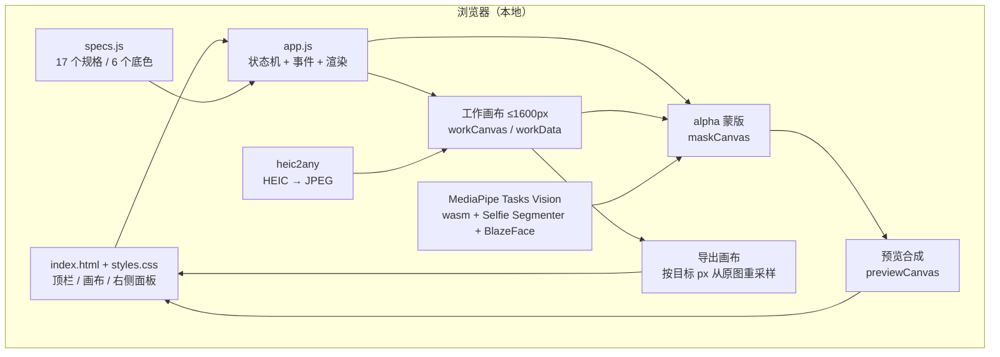

# 工程实现说明

本文描述 ID Photo Studio v1 的实际实现，而不是设计设想。所有参数和函数名都对应仓库里的代码；如果文档与代码冲突，以代码为准。

- 入口：`index.html` → `specs.js` → `app.js`
- 主逻辑：`app.js`（一个 IIFE，约 2.3k 行）
- 无框架、无打包器、无后端
- 目标浏览器：桌面 Chrome / Edge；Safari 尽力兼容

---

## 1. 总体架构



应用只有一个全局状态对象 `state`，包含：

- 原图 `source`、尺寸、文件名；
- 工作画布 `workCanvas`、工作像素 `workData`；
- 蒙版 `maskCanvas`（alpha 存 RGBA 的 A 通道）；
- 预览合成 `previewCanvas`；
- 裁剪框 `crop`（归一化到原图的 `[0,1]`）；
- 输出规格 `outW/outH/dpi/mmW/mmH`；
- 底色、抠图参数、笔刷状态；
- AI 状态机（`loaded/loading/running/error`）；
- 撤销 / 重做栈（最多 12 步）。

---

## 2. 导入与解码

`importFile(file)`：

1. 用 MIME 或扩展名做第一层过滤；
2. `createImageBitmap(file, { imageOrientation: 'from-image', premultiplyAlpha: 'none' })` 解码，并自动纠正 EXIF 方向；
3. 如果失败且文件是 HEIC/HEIF，调用 `heic2any` 转成 JPEG 再解码；
4. 仍然失败则抛出可读错误，界面 toast 提示；
5. `loadBitmap()` 把图像绘制到工作画布。

### 工作画布

`WORK_MAX = 1600`：

```js
const scale = Math.min(1, WORK_MAX / Math.max(sourceW, sourceH));
workW = round(sourceW * scale);
workH = round(sourceH * scale);
```

预览、色键、AI、笔刷都在工作画布上完成。导出时**不**从工作画布放大，而是按裁剪框映射回 `source` 的原图坐标重新采样，避免二次缩放造成发糊。

### 透明底

`detectTransparency()` 扫描 alpha 通道；如果存在明显透明区域，直接使用原图 alpha，标记引擎为“透明底”，不再跑色键或 AI。

---

## 3. 纯色背景检测

`analyzeBackground(imgData)` 从顶部和左右两侧边缘采样：

- 横向取顶部若干行、纵向取左右若干列；
- 丢弃 alpha < 8 的像素；
- 按 `RGB >> 4` 把颜色压到 16 级色阶做直方图（4096 个桶）；
- 取样本最多的桶，计算主色 `mean` 和覆盖率 `coverage`；
- 在距离主色 60 以内的样本上计算标准差 `std`；
- 判定为纯色：`coverage > 0.4 && std < 30`。

结果保存为 `state.bgAnalysis = { mean, coverage, std, solid }`。底色键和自动引擎选择都依赖它。

---

## 4. 色键引擎

`buildColorKeyMask(imgData, bg, tolerance)`：

1. 对每个像素计算与背景主色的欧氏距离 `dist`；
2. 阈值随容差滑杆变化：
   ```js
   t0 = 10 + tolerance * 0.2;  // 确定为背景
   t1 = 30 + tolerance * 0.9;  // 确定为前景
   ```
3. 以顶部和左右边界为种子做 BFS 连通域生长，只保留与边界连通的背景区域，避免把人物内部同色区域误删；
4. 如果初始种子为空，用更宽松的 `t1` 再试一次；
5. 生成软 alpha：
   - `dist <= t0` → 0
   - `dist >= t1` → 255
   - 中间线性映射到 `0..255`
6. 非背景连通域一律 255（保留人物）。

### 去溢色

`despillCanvas(canvas, bgHex, strengthPct)` 对半透明边缘像素做反预乘近似：

```js
unmix = (pixel - (1 - alpha) * bg) / max(alpha, 0.05);
out = pixel + (unmix - pixel) * strength;
```

这能减少蓝底换白底时头发边缘的蓝色描边。强度由“去溢色”滑杆控制。

### 羽化

预览合成时，把蒙版画到 `softMaskCanvas`，使用 Canvas `filter = blur(Npx)`；导出时按 `feather * (outW / maskW)` 换算到目标分辨率，保证不同输出尺寸下视觉羽化一致。

---

## 5. 人像 AI

`ensureAI()` 动态加载：

```js
const mp = await import('./vendor/mediapipe/vision_bundle.mjs');
const fileset = await mp.FilesetResolver.forVisionTasks(wasmPath);
```

- wasm 目录：`vendor/mediapipe/wasm`
- 模型：`vendor/models/selfie_segmenter.tflite`
- 优先 `delegate: 'GPU'`，失败自动退回 CPU；
- 人脸检测模型：`vendor/models/blaze_face_short_range.tflite`，用于 AI 模式下的自动构图；加载失败不影响抠图。

`runAI(auto)`：

1. `segmenter.segment(workCanvas)` 得到 `confidenceMasks`；
2. 取第 2 个 mask（人像前景），读取 `Float32Array`；
3. 双线性上采样到 `workW × workH`；
4. 用原图亮度做引导图，跑 `guidedFilter(alpha, guide, W, H, 3, 0.001)` 细化边缘；
5. 写入蒙版，标记引擎为 `ai`；
6. 如果人脸检测可用，取最大人脸并按“头顶留白约 10%”调整裁剪框（用户手动调过裁剪则不再自动移动）；
7. `renderComposite()`。

### 引导滤波

`guidedFilter()` 是标准的盒式滤波实现：

- 均值滤波窗口半径 `r = 3`；
- 正则项 `eps = 0.001`；
- 计算 `mean_I`、`mean_p`、`corr_I`、`corr_Ip`，得到线性系数 `a/b`；
- 再对 `a/b` 做均值，输出 `mean_a * I + mean_b`。

相对直接使用低分辨率模型 mask，这一步能显著减少锯齿和“纸片人”边缘。

### 失败回退

- `file://` 直接打开：`ensureAI()` 直接 reject，提示用 `启动.bat`；
- 模型加载失败：如果 `auto=true`，回退色键并提示“AI 不可用，已退回色键”；否则 toast 报错；
- 没有 GPU：自动走 CPU delegate。

---

## 6. 合成与渲染

`renderComposite()`：

1. 羽化蒙版 → `softMaskCanvas`；
2. 工作画布 `destination-in` 蒙版 → 前景 `fgCanvas`；
3. 去溢色（笔刷拖动过程中跳过，避免卡顿）；
4. 画底色（纯色或轻微渐变）→ `previewCanvas`；
5. 把前景叠上去；
6. `renderView()` 按视口缩放、平移和裁剪框显示。

`requestComposite()` 用 `requestAnimationFrame` 合并合成请求；连续拖动滑杆时不会堆积渲染任务。`renderView()` 本身是同步绘制，由合成或指针事件直接调用。

### 裁剪坐标

- `state.crop = { x, y, w, h }`，全部归一化到原图 `[0,1]`；
- `fitCropToAspect()` 根据目标宽高比取最大内接矩形；
- 拖动 / 四角缩放通过 `hitTestCrop()` 和 `resizeCropFromPointer()` 修改；
- 导出时：
  ```js
  sx = crop.x * sourceW;
  sy = crop.y * sourceH;
  sw = crop.w * sourceW;
  sh = crop.h * sourceH;
  drawImage(source, sx, sy, sw, sh, 0, 0, outW, outH);
  ```
  直接从原图重采样，工作画布只用于蒙版坐标映射。

---

## 7. 导出

`buildExportBlob()` 是导出的唯一入口：

1. 读取格式（JPEG/PNG）、质量、目标 KB、文件名；
2. 按裁剪框从 `source` 重采样到 `outW × outH`；
3. 把 `maskCanvas` 的对应区域按目标尺寸重绘，并按 `feather` 计算 blur 半径；
4. `destination-in` 得到前景，去溢色；
5. 画底色 + 前景；
6. 编码：
   - 普通模式：`toBlob(mime, quality)`；
   - 目标 KB 模式：JPEG 质量 0.3–0.95 二分 8 次，取“不超过目标的最大质量”；如果始终压不到，返回最小质量结果并提示；PNG 为无损编码，不参与目标 KB 模式，界面会禁用质量与目标 KB 控件；
7. 写入 DPI 元数据；
8. 生成文件名：`sanitizeName(输入名) + '_' + outW + 'x' + outH + '.' + ext`。

### JPEG DPI

`patchJpegDpi(buffer, dpi)`：

- 解析 JPEG 段，找到 APP0 `JFIF`；
- 把 density units 设为 1（dots/inch），写入 X/Y density；
- 如果不存在 APP0，则在 SOI 后插入一个新的 APP0 段。

### PNG DPI

`patchPngDpi(buffer, dpi)`：

- 校验 PNG 签名；
- `ppm = round(dpi / 0.0254)`；
- 查找已有 `pHYs` chunk：有则替换 9 字节数据并重算 CRC32；没有则在 `IHDR` 后插入新 chunk；
- CRC32 使用标准多项式 `0xEDB88320` 查表实现。

### 文件名

`sanitizeName()` 过滤 `\ / : * ? " < > |` 等 Windows 非法字符，空名回退为“证件照”。

---

## 8. PWA 与离线

`registerSW()`：

- 只在 `https:`、`localhost` 或 `127.0.0.1` 下注册；
- `window.load` 后注册 `./sw.js`；
- 失败只 `console.warn`，不影响主流程。

`sw.js`：

- `CACHE = 'idphoto-v5'`（修改静态文件时手动 +1）；
- install 阶段先用 `WebAssembly.instantiate` 跑 MediaPipe 同款 SIMD 探测，只把当前浏览器会加载的 SIMD 或非 SIMD wasm 变体加进缓存，再逐个 `fetch(..., { cache: 'reload' })` 并 `cache.put`，单个资源失败不阻断整体；
- activate 阶段只清理 `idphoto-` 前缀的旧版本缓存（同源下可能有其他 GitHub Pages 项目），然后 `clients.claim()`；
- fetch 阶段：
  - 只处理同源 GET；
  - `cache-first`，命中直接返回；
  - 未命中则请求网络，成功就顺手缓存（wasm / 模型首次用到时也会被缓存）；
  - 导航请求失败时回退到缓存的 `index.html`。

缓存清单约 16MB：页面、样式、脚本、manifest、图标、heic2any、MediaPipe bundle、当前浏览器对应的一对 wasm（SIMD 或非 SIMD）、人像模型、人脸模型。

> 局域网 HTTP 不是安全上下文（Secure Context），浏览器不会注册 Service Worker；因此“手机离线、电脑关机”必须走 HTTPS 托管。这是浏览器规范决定的，不是应用能绕过的。

---

## 9. 本地启动器

`启动.bat` 只做两件事：

```bat
title ID Photo Tool
powershell -NoProfile -ExecutionPolicy Bypass -File "%~dp0server.ps1"
```

`server.ps1`：

- 用 `System.Net.Sockets.TcpListener` 监听 `0.0.0.0`；
- 从 `8765` 开始，端口占用自动顺延最多 20 个；
- 手写最小 HTTP/1.1 响应：`Content-Type`、`Content-Length`、`Connection: close`、`Cache-Control: no-cache`、`X-Content-Type-Options: nosniff`、`Content-Security-Policy: connect-src 'self'`；
- 路径经过 `GetFullPath` + 前缀校验，防止 `..` 目录穿越；
- 使用应用文件白名单（`index.html`、`app.js`、`specs.js`、`styles.css`、`sw.js`、`manifest.webmanifest`、`icons/`、`vendor/`、OG 图片）；`.git/`、`.work/`、`tests/`、`部署包.zip` 等返回 404；
- 只接受 GET / HEAD，不处理上传、POST 业务或执行请求；没有目录列表；
- 启动后打印本机与局域网地址，并尝试自动打开浏览器。

---

## 10. 性能

- **工作画布上限 1600px**：预览和抠图的像素量可控；导出另走原图重采样。
- **TypedArray**：色键距离、连通域队列、蒙版 alpha 都用 `Float32Array` / `Uint8Array` / `Int32Array`，避免大量对象分配。
- **BFS 队列预分配**：`Int32Array(W * H)`，不动态 push。
- **requestAnimationFrame**：合成请求合并到下一帧；滑杆拖动不会每像素渲染。
- **Worker 未使用**：v1 的色键和渲染在主线程足够快；AI 推理是同步调用，首次加载会显示 busy 遮罩。后续若加入批量处理，再把重计算搬进 Worker。
- **大图**：`createImageBitmap` 解码后按 `WORK_MAX` 缩放；原图仍保留用于导出。极端大图会占用较多内存，但不会上传。

---

## 11. 测试

### 浏览器自测

`app.js` 末尾的 `runSelfTests()` 覆盖 9 项：

1. 25mm @300dpi → 295px
2. 35mm @300dpi → 413px
3. 26mm @350dpi → 358px
4. 32mm @350dpi → 441px
5. 文件名清洗
6. 纯色背景识别 + 色键蒙版
7. JPEG DPI 写入
8. PNG DPI 写入
9. 目标 KB 编码

`?exporttest=1` 进一步走完整导出链路：分别以 JPEG 和 PNG 各导出一次，断言文件签名、295×413 输出尺寸、DPI（JPEG 的 JFIF APP0 / PNG 的 `pHYs`）；`?swtest=1` 检查 Service Worker 缓存中 index、app、模型、MediaPipe bundle 和当前 wasm 变体都存在；`?aitest=1` 加载模型并分割演示图。

### CI

`tests/smoke.py` 启动本地 `http.server`，用 Playwright 打开：

- `?selftest=1` → 断言 `SELFTEST PASS`
- `?exporttest=1` → 断言 `EXPORTTEST PASS`
- `?demo=1` → 断言纯色背景识别、导出按钮可用、画布有像素
- `?swtest=1` → 断言 `SWTEST PASS`

这样 CI 覆盖了尺寸计算、色键、DPI、目标 KB、完整导出和 PWA 注册，不依赖 GPU 或大模型。

---

## 12. 隐私与安全边界

- 没有 `fetch` 用户照片的代码；应用只请求自己的同源静态资源。
- 用 CSP `connect-src 'self'` 阻止 MediaPipe 上游运行时的匿名遥测外发；照片像素不在任何请求里。
- 没有 `localStorage` / IndexedDB 保存照片；设置也不持久化（v1）。
- 本地服务器只读静态文件，使用应用文件白名单，无上传端点；路径穿越做了前缀校验。
- 不使用 `eval` / `new Function`；第三方库固定在 `vendor/`，不从 CDN 运行时代码加载。MediaPipe 上游 wasm 中用于遥测的公共 Google key 已替换为等长占位符，遥测另由 CSP 阻止；披露见 `THIRD_PARTY_NOTICES.md`。
- 主要风险不在应用代码，而在宿主环境：恶意浏览器扩展、输入法、被攻破的系统、或用户自己把导出图发给别人。

---

## 13. 代码地图

| 区域 | 关键函数 |
| --- | --- |
| 常量 / 工具 | `clamp`, `normalizeHex`, `mmToPx`, `sanitizeName` |
| 初始化 | `init`, `populatePresets`, `populateSwatches`, `bindEvents` |
| 规格 / 裁剪 | `applySpec`, `fitCropToAspect`, `refitCropToAspect`, `normAspect` |
| 导入 | `importFile`, `decodeImage`, `loadBitmap`, `detectTransparency` |
| 色键 | `analyzeBackground`, `buildColorKeyMask`, `applyColorKey` |
| AI | `ensureAI`, `runAI`, `pickLargestFace`, `autoPositionCrop`, `guidedFilter` |
| 合成 / 渲染 | `paintBackground`, `despillCanvas`, `renderComposite`, `renderView` |
| 笔刷 / 撤销 | `drawDab`, `drawBrushLine`, `pushUndo`, `restoreSnapshot` |
| 导出 | `encodeOnce`, `encodeTarget`, `patchJpegDpi`, `patchPngDpi`, `buildExportBlob` |
| PWA | `registerSW`, `runSWTest` |
| 自测 / 演示 | `runSelfTests`, `makeDemoImage`, `loadDemo`, `runAITest` |

---

## 14. 后续方向

- 把 AI 推理和批量处理搬进 Web Worker，保持主线程流畅。
- 增加批处理队列与全套导出（一寸/二寸 × 红/蓝/白）。
- 6 寸相纸排版打印（带裁切线）。
- 美颜 / 换正装作为可选、默认关闭的功能，并在界面提示证件照审核风险。
- 更多规格预设和用户自定义预设保存。

这些都不在当前 v1 范围内；README 的 Roadmap 与实际实现保持同步。
